# Ajolotito Notificaciones — TDD completo (Rondas 1–13)

Implementación por rondas del manual `Manual_TDD_AjolotitoNotificaciones.docx`.
**Flutter 3.47.6 · Dart 3.13.5 · flutter_test**

| Resultado final | |
|---|---|
| `flutter test` | **74 tests · All tests passed** |
| `dart analyze` | **No issues found** |
| Archivos de prueba | **7** (`mascota`, `politica_payload`, `planificador`, `permiso`, `servicio`, `vm`, `pantalla`) |

```bash
flutter pub get
flutter test
```

---

## Resumen por ronda

| Ronda | Qué se hizo (breve) | Tests |
|-------|---------------------|-------|
| 0 | Los 10 mandamientos de una notificación (conceptual, sin código). | — |
| 1 | Setup: `pubspec`, manifiesto Android (2 permisos + 2 receivers), desugaring, delegate iOS. | — |
| 2 | `Reloj` + `Mascota`: saciedad, humor, predicción, alimentar, JSON. | 16 |
| 3 | Categorías/canales Android y mensajes con personalidad. | 16 |
| 4 | Política: silencio nocturno, tope diario, ajuste de horas. | 28 |
| 5 | Payload versionado (`v1:destino`) tolerante a basura. | 28 |
| 6 | Planificador: ids fijos, colapso, tope, ventana de 3 días. | 41 |
| 7 | Puerto de notificaciones + `PuertoFalso`. | 41 |
| 8 | Permiso en 3 estados (`sinPreguntar/concedido/denegado`) + almacén. | 47 |
| 9 | `ServicioAjolote`: sincronización, primer/segundo plano, modo clase. | 61 |
| 10 | Adaptador real del plugin (`PuertoReal`) + `SharedPreferences`. | 61 |
| 11 | ViewModel, pantallas, dibujo del ajolote y arranque (`main`). | 74 |
| 12 | Checklist de prueba en dispositivo real (manual). | 74 |
| 13 | Push remoto: conceptual; el manual indica que **no** se implementa. | — |

---

## Capturas por ronda

### Ronda 1 — Setup
`pubspec.yaml`, `AndroidManifest.xml` (2 permisos + 2 receivers), `build.gradle.kts` con desugaring y `AppDelegate.swift`.


### Ronda 2 — Reloj + Mascota
Ciclo completo **ROJO → VERDE → REFACTOR** con 16 pruebas.

<p>
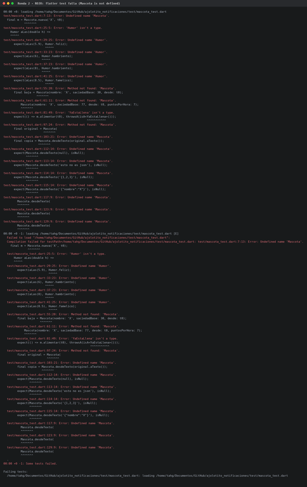
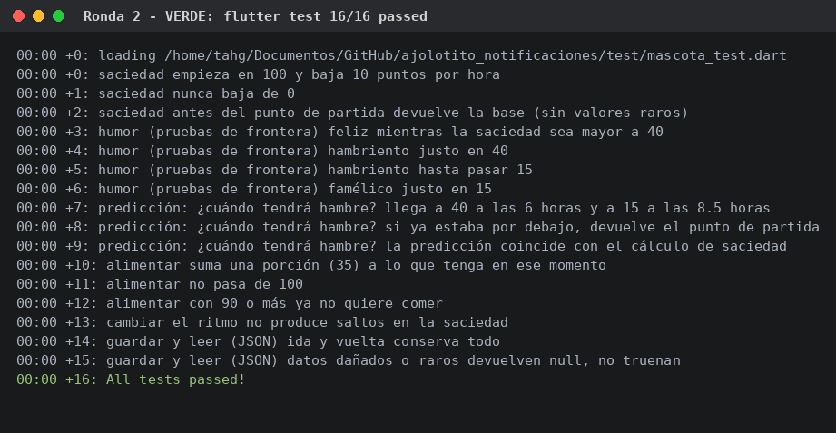

</p>

### Ronda 3 — Categorías, canales y mensajes
Dos canales (hambre alta, sorpresas baja) y textos deterministas por semilla.

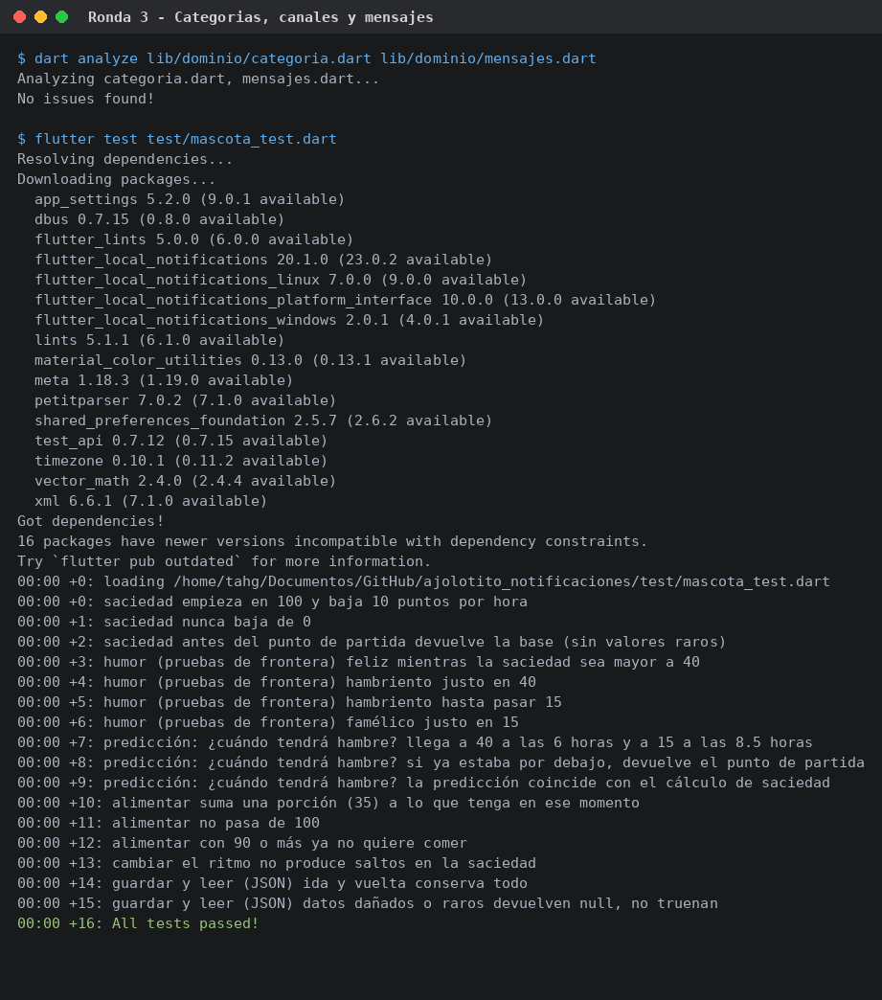

### Ronda 4 — Política de buena educación
Silencio 22:00–08:00 (cruza medianoche), mover al final del silencio y tope diario.

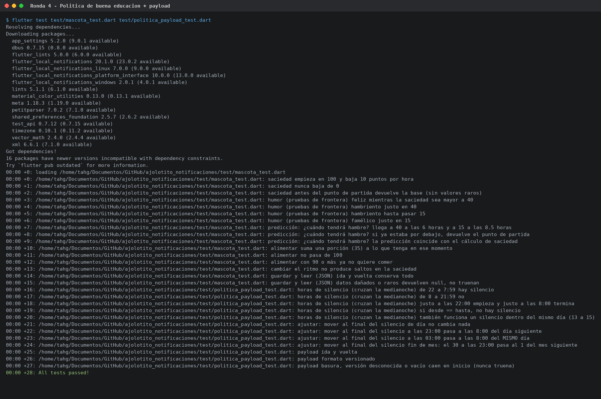

### Ronda 5 — Payload
`v1:destino`; cualquier dato raro abre en `inicio` sin lanzar.

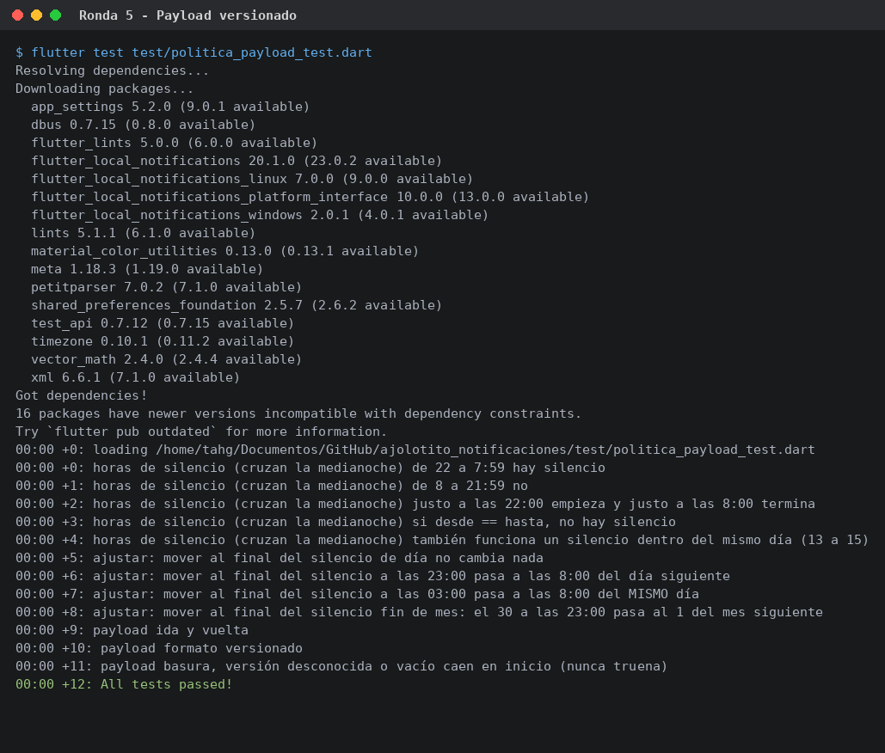

### Ronda 6 — Planificador
Ids fijos, colapso de avisos cercanos, nada en silencio, 3 sorpresas adelantadas.

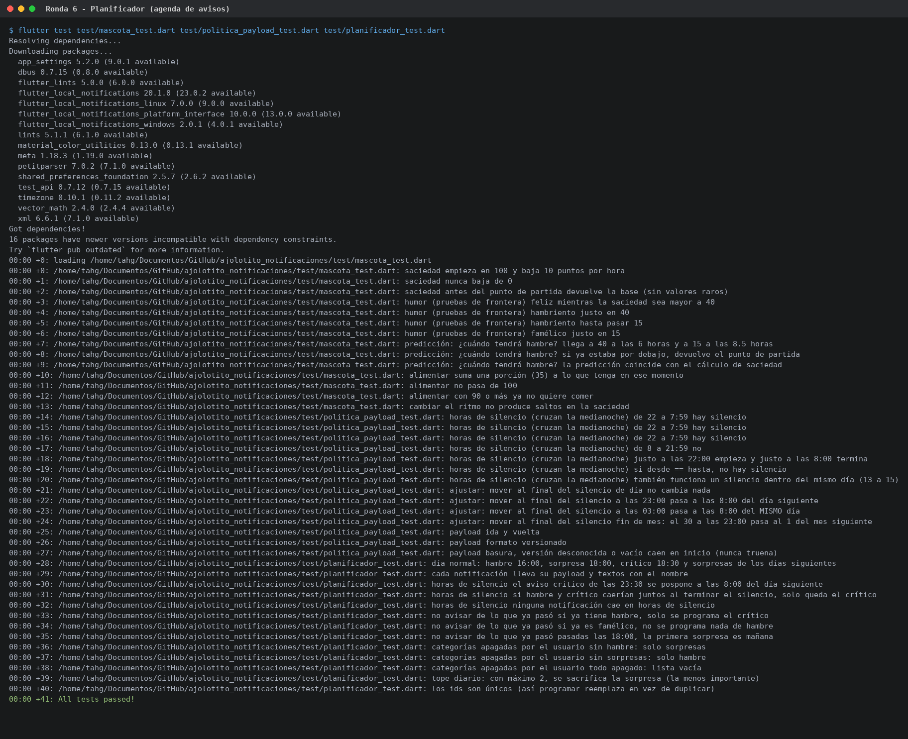

### Ronda 7 — Puerto y doble de pruebas
Interfaz `PuertoNotificaciones` y `PuertoFalso` (mismo id reemplaza).

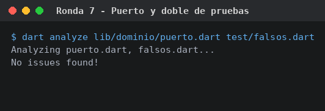

### Ronda 8 — Permiso con inteligencia
Pedir una sola vez, en contexto; si deniega, guiar a Ajustes sin insistir.

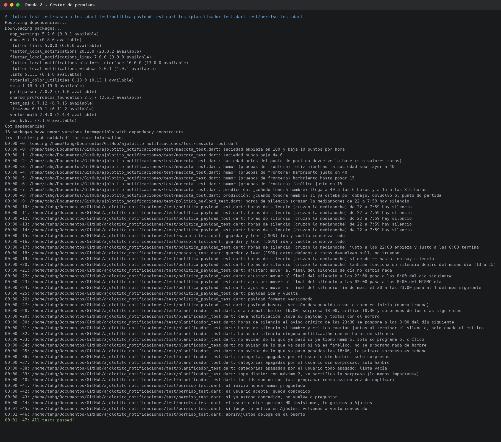

### Ronda 9 — Servicio sincronizado
Cancelar → comprobar permiso → reprogramar; sin hambre en primer plano.

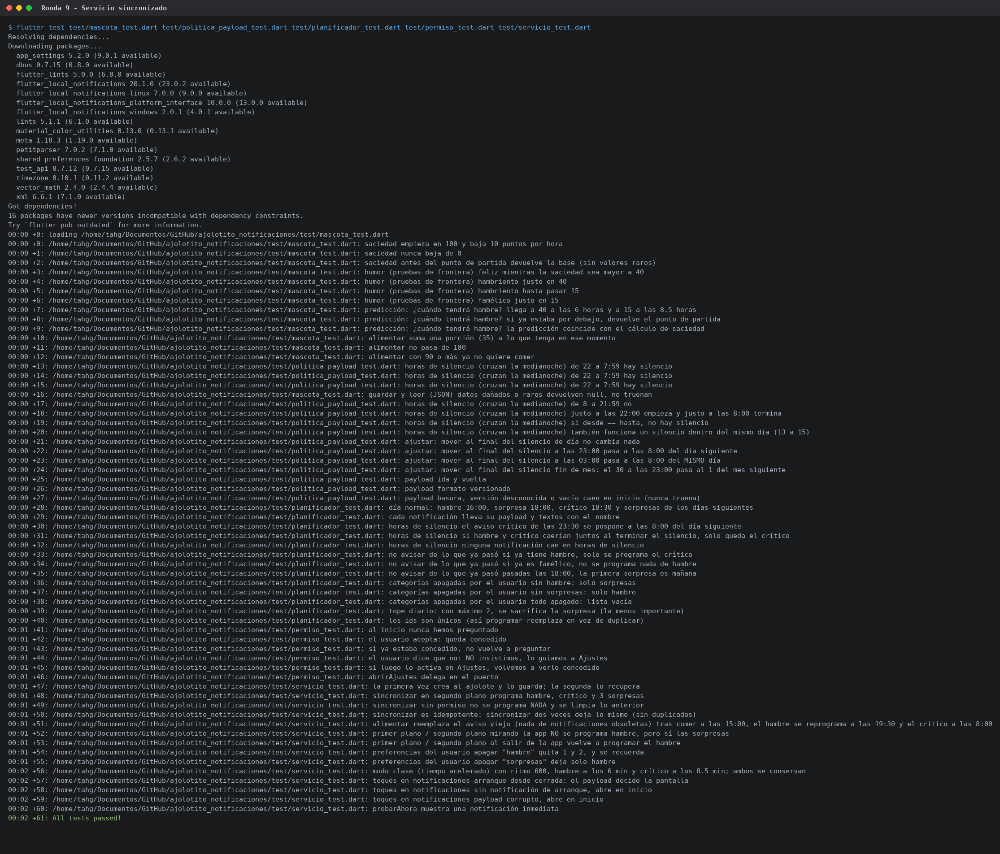

### Ronda 10 — Adaptador real
Único archivo que toca el plugin: zona horaria, canales, alarmas inexactas, acciones.

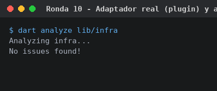

### Ronda 11 — ViewModel y pantallas
Estado observable, diálogo de pre-permiso, ajustes por categoría y modo clase.

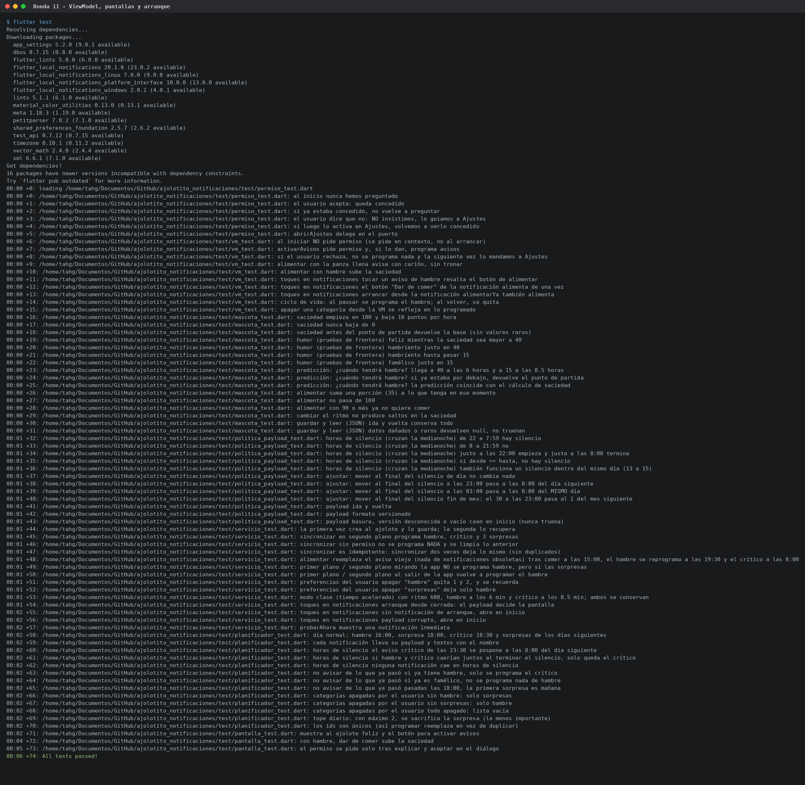

### Ronda 12 — Verificación en dispositivo
Suite completa + análisis estático; el recorrido físico sigue la checklist del manual.

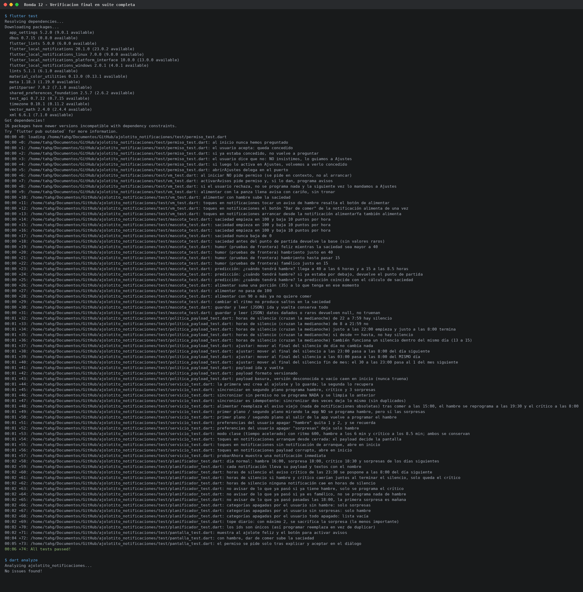

### Ronda 13 — Push (conceptual)
El manual explica FCM/APNs y el patrón de puerto, pero **no implementa push**.

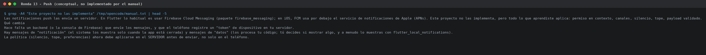

---

## Estructura

```
lib/
├── dominio/      reloj, mascota, categoria, mensajes, politica, payload,
│                 planificador, puerto, almacen, gestor_permiso, servicio
├── infra/        puerto_real, almacen_prefs
├── presentacion/ ajolote_vm, dibujo_ajolote, pantalla_ajolote, pantalla_ajustes
├── app.dart
└── main.dart
test/             mascota, politica_payload, planificador, permiso,
                  servicio, vm, pantalla (+ falsos)
evidence/         capturas por ronda (PNG + log)
```

> Las capturas son renderizados de la salida real de `flutter test` / `dart analyze`
> guardada en `evidence/rondaN/captura.txt`.
