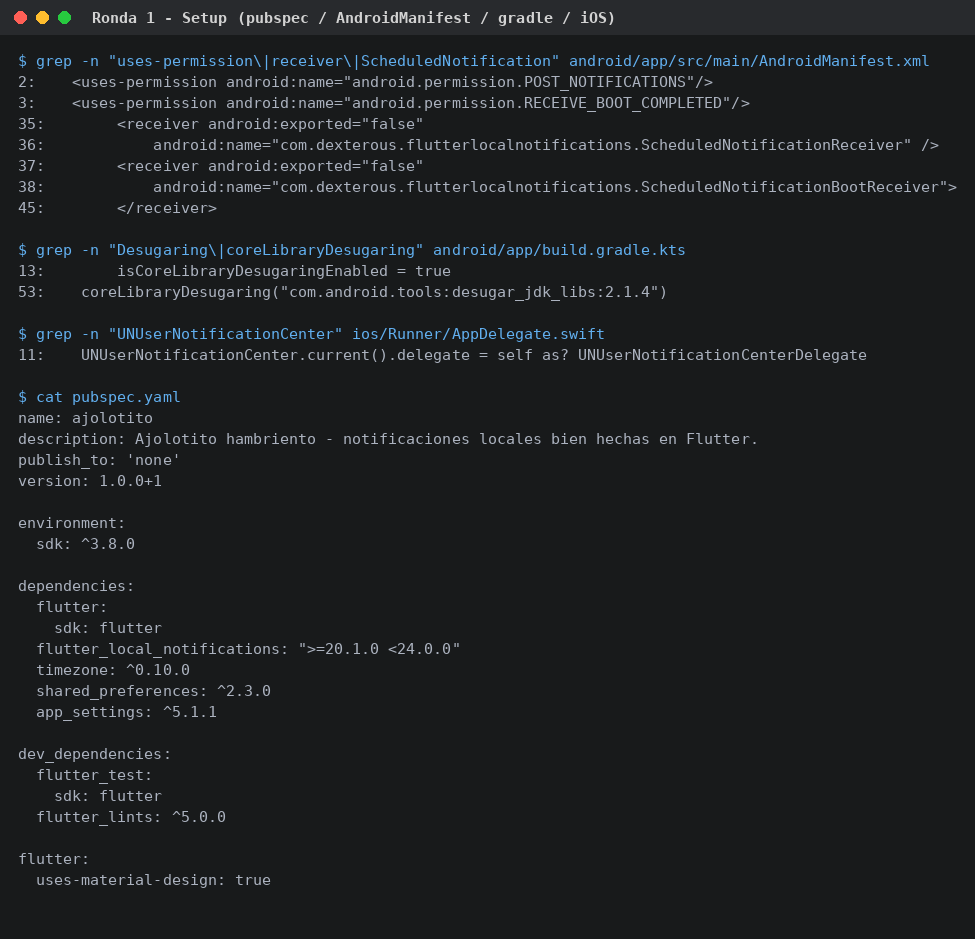

# Ajolotito Notificaciones — TDD (Rondas 1 y 2)

Repositorio de evidencia del ciclo **TDD ROJO → VERDE → REFACTOR** para el proyecto
**Ajolotito hambriento**, siguiendo el `Manual_TDD_AjolotitoNotificaciones.docx`.

- **Stack:** Flutter 3.47.6 · Dart 3.13.5 · `flutter_test`
- **Carpeta de pruebas:** `test/` (convención Flutter, **no** `tests/`)
- **Dominio:** `lib/dominio/` (**no** `lib/models/`)

---

## Estructura del proyecto

```
ajolotito_notificaciones/
├── pubspec.yaml
├── lib/
│   ├── main.dart
│   └── dominio/
│       ├── reloj.dart          # Reloj, RelojSistema, RelojFalso
│       └── mascota.dart        # Humor, YaEstaLlena, Mascota
├── test/
│   └── mascota_test.dart       # 16 pruebas (saciedad, humor, predicción, alimentar, ritmo, JSON)
├── android/app/
│   ├── src/main/AndroidManifest.xml   # 2 permisos + 2 receivers
│   └── build.gradle.kts               # desugaring
├── ios/Runner/AppDelegate.swift        # delegate de notificaciones
├── evidence/
│   ├── ronda1/
│   │   ├── 01_setup_config.txt
│   │   └── captura_ronda1_setup.png
│   └── ronda2/
│       ├── 01_red_test_failing.txt
│       ├── captura_ronda2_rojo.png
│       ├── 02_green_test_passing.txt
│       ├── captura_ronda2_verde.png
│       ├── 03_refactor_test_passing.txt
│       └── captura_ronda2_refactor.png
└── reports/
    └── RONDA2_RESULTS.md
```

---

## Ronda 1 — Setup

Configuración nativa necesaria para notificaciones locales:

| Archivo | Cambio |
|---------|--------|
| `pubspec.yaml` | Dependencias exactas: `flutter_local_notifications ">=20.1.0 <24.0.0"`, `timezone`, `shared_preferences`, `app_settings`; dev: `flutter_lints` |
| `android/app/src/main/AndroidManifest.xml` | `POST_NOTIFICATIONS`, `RECEIVE_BOOT_COMPLETED`; receivers `ScheduledNotificationReceiver` y `ScheduledNotificationBootReceiver` con sus intent-filters |
| `android/app/build.gradle.kts` | `isCoreLibraryDesugaringEnabled = true` + `coreLibraryDesugaring("com.android.tools:desugar_jdk_libs:2.1.4")` |
| `ios/Runner/AppDelegate.swift` | `UNUserNotificationCenter.current().delegate = self as? UNUserNotificationCenterDelegate` |

**Captura de la ronda:**



---

## Ronda 2 — Reloj + Mascota (TDD)

### 🔴 ROJO — el test falla primero

Se escribió `test/mascota_test.dart` **antes** de la implementación y se ejecutó
`flutter test`. Resultado real: `Some tests failed` con
`Error: Undefined name 'Mascota'`, `'Humor' isn't a type` y
`'YaEstaLlena' isn't a type`.

Log: [`evidence/ronda2/01_red_test_failing.txt`](evidence/ronda2/01_red_test_failing.txt)


### 🟢 VERDE — código mínimo para pasar

Se implementaron `lib/dominio/reloj.dart` y `lib/dominio/mascota.dart`.
Resultado real: **`00:00 +16: All tests passed!`**

Log: [`evidence/ronda2/02_green_test_passing.txt`](evidence/ronda2/02_green_test_passing.txt)


### 🔵 REFACTOR — limpieza sin romper

`dart format` + validación defensiva en `desdeTexto` (chequeos `is`, nunca lanza) y
extracción de constantes. Resultado real: **sigue `00:00 +16: All tests passed!`**

Log: [`evidence/ronda2/03_refactor_test_passing.txt`](evidence/ronda2/03_refactor_test_passing.txt)


### Resultado de las 16 pruebas

| Grupo | Tests | Verde |
|-------|-------|-------|
| `saciedad` | 3 | ✅ |
| `humor (pruebas de frontera)` | 4 | ✅ |
| `predicción: ¿cuándo tendrá hambre?` | 3 | ✅ |
| `alimentar` | 3 | ✅ |
| `cambiar el ritmo no produce saltos en la saciedad` | 1 | ✅ |
| `guardar y leer (JSON)` | 2 | ✅ |
| **Total** | **16** | **16/16** |

Detalle completo con estado RED/GREEN por test: [`reports/RONDA2_RESULTS.md`](reports/RONDA2_RESULTS.md)

---

## Fórmula de saciedad implementada

```dart
double saciedadEn(DateTime t) {
  if (!t.isAfter(desde)) return saciedadBase;
  final horas =
      t.difference(desde).inMicroseconds / Duration.microsecondsPerHour;
  return max(0.0, saciedadBase - horas * puntosPorHora);
}
```

- **Humor:** `<= 15` famélico · `<= 40` hambriento · resto feliz.
- **Predicción:** `desde + (saciedadBase - umbral) / puntosPorHora` horas.
- **Alimentar:** `+35`, tope 100; lanza `YaEstaLlena` si la saciedad es `>= 90`.
- **conRitmo:** conserva la saciedad actual y cambia el ritmo (sin saltos).
- **JSON:** `aTexto()` / `desdeTexto()` con round-trip y validación total.

---

## Erratas del manual corregidas

1. `throwsA(isA<YaEstaLlena>()` → `throwsA(isA<YaEstaLlena>())`
2. `Duration(` sin cerrar en `momentoEnQueBajaA` → cerrado
3. Llaves `}` extra al final de `Mascota` → eliminadas
4. `List<String,String>` en `mensajes.dart` (futuro) → `List<(String,String)>`
5. `tests/` → `test/`
6. `com.android.tools.desugar_jdk_libs:2.1.4` → coordenada Gradle válida `com.android.tools:desugar_jdk_libs:2.1.4`

---

## Cómo ejecutar

```bash
flutter pub get
flutter test
```

Salida esperada:

```
00:00 +16: All tests passed!
```
